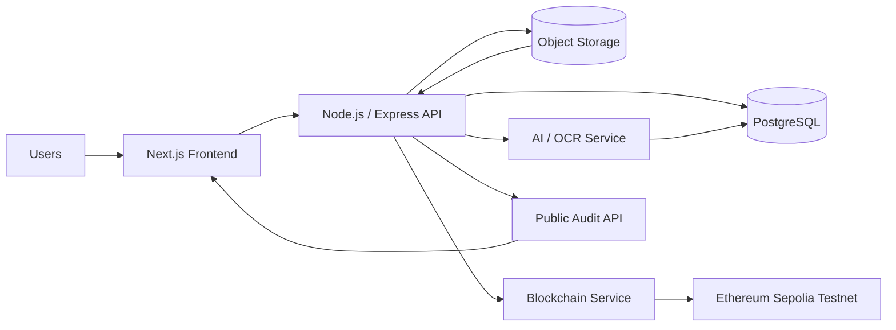

# DanaTerang — System Architecture

## 1. Architecture Overview

DanaTerang uses a hybrid architecture.

```text
Frontend
  ↓
Backend API
  ├── PostgreSQL
  ├── Object Storage
  ├── AI/OCR Service
  └── Blockchain Service
```

## 2. Responsibility by Layer

### Frontend

Technology:

- Next.js
- TypeScript
- Tailwind CSS

Responsibilities:

- dashboards,
- campaign management,
- evidence upload,
- review interfaces,
- public audit page,
- technical proof details.

### Backend API

Technology:

- Node.js
- Express

Responsibilities:

- authentication,
- authorization,
- campaign logic,
- milestone logic,
- evidence workflow,
- verification workflow,
- optional external-payment reports attributed to their source (no payment execution or independent settlement verification),
- blockchain orchestration,
- audit logging.

### PostgreSQL

Stores application state:

- users,
- organizations,
- campaigns,
- milestones,
- evidence metadata,
- OCR results,
- flags,
- verification records,
- optional external-payment report metadata,
- blockchain transaction references,
- audit logs.

### Object Storage

Stores raw evidence:

- receipts,
- invoices,
- photos,
- reports,
- contracts.

Originals remain in private storage. If a redacted derivative is produced, it is stored as a separate file with its own SHA-256 hash; it never replaces the original.

Recommended:

- S3-compatible storage,
- Cloudflare R2,
- MinIO,
- Supabase Storage.

### AI/OCR Service

Responsibilities:

- OCR extraction,
- Indonesian and English document handling,
- per-field confidence output,
- field parsing,
- duplicate detection,
- amount consistency check,
- date consistency check,
- missing-field detection,
- anomaly flags.

### Blockchain Layer

Technology:

- Solidity smart contract on Ethereum Sepolia Testnet,
- ethers.js from the backend service.

Responsibilities:

- store the SHA-256 canonical package hash for the reviewed evidence version (Phase 1 default),
- optionally support a separately specified Merkle-root profile,
- milestone reference,
- verification status proof,
- timestamp,
- immutable transaction reference.

Phase 1 uses EIP-712 Verifier signatures and a Solidity quorum contract for 2-of-3 decisions, then anchors a versioned evidence/review commitment. Assigned Verifiers sign with organization-controlled wallets; the backend relays transactions and pays gas in Sepolia ETH. Organizers and Funders do not connect wallets. Payment reports remain off-chain and are not included in the demo proof.

## 3. Architecture Diagram



The public API returns only an approved non-sensitive projection. It must not expose private object-storage URLs, full OCR results, payment references, or internal review notes by default.

## 4. Trust Boundaries

### Application Trust

Managed by:

- backend authentication,
- RBAC,
- validation,
- audit logs.

### Evidence Trust

Managed by:

- raw evidence hash,
- file versioning,
- metadata,
- screening,
- human verification.

### Immutable Proof Trust

Managed by:

- blockchain transaction,
- evidence proof,
- transaction reference.

## 5. Failure Handling

If blockchain anchoring fails:

- evidence must remain stored,
- database state must remain safe,
- anchoring request should be queued,
- retry should be possible.

Blockchain failure must not delete or invalidate off-chain data.

OCR failure must also remain visible as a processing/failure state; it must not be presented as a clear result. The Phase 1 demo keeps the uploaded evidence and its version history available for review or retry.
