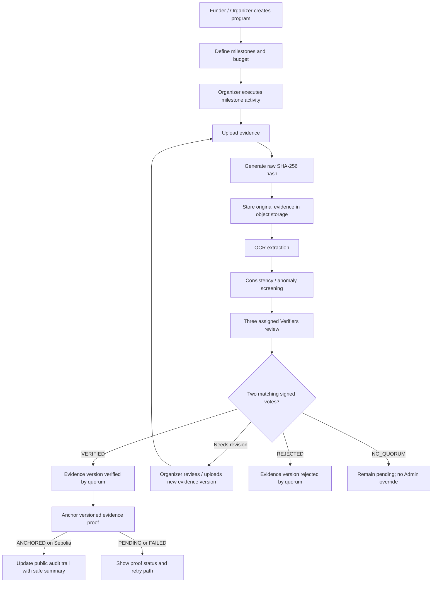

# DanaTerang — User Flow

## 1. End-to-End Core Flow



## 2. Main Use Case

### Example: CSR School Renovation

A company allocates IDR 100,000,000 for a school renovation program.

Milestones:

- Material purchase — IDR 30,000,000
- Structural renovation — IDR 40,000,000
- Finishing — IDR 30,000,000

The NGO uploads:

- receipts,
- invoices,
- progress photos,
- activity report.

DanaTerang:

1. hashes the original files,
2. stores the files,
3. extracts receipt data,
4. detects inconsistencies,
5. sends the case to an assigned peer panel,
6. shows whether the submitted evidence version is approved, requires revision, or rejected,
7. records the verifier decision against the reviewed evidence version,
8. anchors a versioned proof commitment,
9. exposes a non-sensitive summary and proof on the public audit page.

Payment is external. If a funder manually reports it, the page attributes that report to the funder and does not describe it as independently verified.

## 3. Tracking-Only Mode

```mermaid
sequenceDiagram
    participant F as Funder
    participant O as Organizer
    participant D as DanaTerang
    participant V as Assigned Verifier Panel (3)
    participant B as Blockchain

    F->>O: External transfer (outside DanaTerang; optional)
    O->>D: Create milestone evidence
    D->>D: Hash + OCR + screening
    D->>V: Assign version-specific peer review
    V->>B: Submit EIP-712 vote signature (relayed; service pays gas)
    B-->>D: Finalize matching 2-of-3 outcome
    D->>B: Anchor evidence/review proof
    opt Funder reports external payment
        F->>D: Submit attributed payment report
    end
    D-->>F: Updated audit trail
```

## 4. Optional External Payment Report

Payment handling is not part of the demo's required evidence-review flow. DanaTerang does not hold, move, or independently verify the funds.

If manually recorded, the product must identify the reporting party and describe the payment as reported, not as a verified settlement. Payment references and supporting files remain private by default and are not anchored as part of the demo proof.

Optional reporting flow:

```text
Funder Pays Externally
→ Funder Reports Payment (optional)
→ DanaTerang Labels the Report with Its Source
```

Payment states are separate from verifier and blockchain states: `READY_FOR_PAYMENT` means the funder is authorized to proceed, `PAYMENT_REPORTED` means a funder reported an external transfer, and `CONFIRMED` requires an independent settlement source. Phase 1 may show `PAYMENT_REPORTED` only; it must not infer `CONFIRMED` from a manual report.

## 5. Evidence Revision Flow

Evidence must be versioned.

Do not overwrite history.

```text
Evidence V1
→ Flagged
→ Superseded

Evidence V2
→ Reviewed
→ Verified by 2-of-3 peer quorum
```

Each version must have:

- separate raw hash,
- uploader,
- timestamp,
- status,
- previous version reference.

## 6. Public Verification Flow

Public user opens campaign URL.

The public page may show only information approved for public release:

- campaign title,
- total budget,
- milestone progress,
- evidence status,
- screening result summary,
- verification status,
- optional payment report and its reporting party,
- blockchain proof status.

Original evidence is not downloadable by default. A public user must not be told they can re-hash a private file they cannot access. A blockchain proof confirms the integrity/time of a commitment, not the truth of the submitted evidence.

If an approved redacted derivative is released, show it separately from the private original and display its own redacted-file hash. The original raw hash remains distinct and unchanged.

Technical details such as:

- evidence hash,
- transaction hash,
- block number,
- timestamp

should be available through a secondary detail view.

Canonical package fields and hashing rules are specified in `BlockchainProof.md`, and status domains/transitions are specified in `StatusStateMachines.md`. Publication/consent rules for redacted derivatives and calibrated numeric OCR thresholds remain pilot decisions in `MVPPhases.md`.

The demo's peer quorum and proof are anchored on Ethereum Sepolia Testnet and link to Sepolia Etherscan. Assigned Verifiers sign votes with organization-controlled wallets; Organizers and Funders do not connect wallets. Status fields stay domain-specific as listed in `StatusStateMachines.md`; for example, screening `CLEAR`, quorum verification `VERIFIED`, disbursement `READY_FOR_PAYMENT`, and proof `ANCHORED` are separate values with separate meanings.
